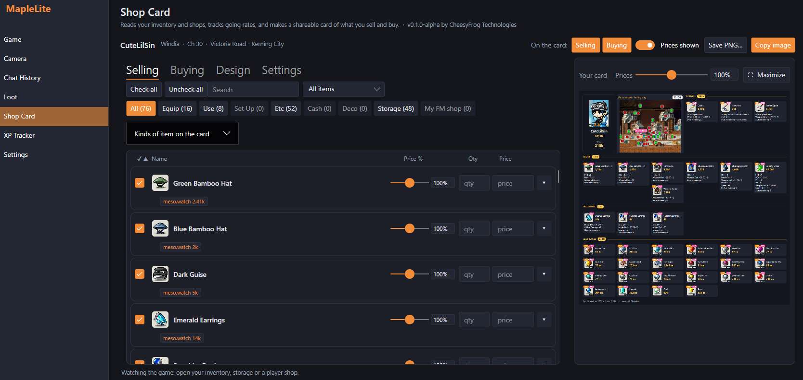

# MapleLite

A plugin host for **MapleStory Classic World**. It runs on **Windows, macOS
and Linux** from one codebase (.NET 8 + Avalonia).

MapleLite is **passive**. It reads the game only from pictures of its window. It never injects code,
reads game memory, captures packets, or sends input to the game, and neither can its plugins.

> [!WARNING]
> **MapleLite is alpha software (0.1.0-alpha).** Expect bugs, missing features and changes between versions,
> including to saved data.
>
> **Plugins read the game with OCR (text recognition on screenshots), so what they show can be wrong.** A misread
> name, price, quantity or number leads to wrong totals, rates and logs. Check anything that matters, such as a price
> before you trade, against the game itself.


## Projects

| Project | What it is |
|---|---|
| `src/MapleLite.Core` | No UI, no OS calls. Frames, the **shared OCR service**, the capture loop, platform interfaces. |
| `src/MapleLite.Sdk` | The plugin API (`IPlugin`, `IPluginContext`), theme tokens, themed panel helpers. Plugins reference only this. |
| `src/MapleLite.Platform.Windows` | Window finding + mode detection, Windows.Graphics.Capture, Windows OCR. |
| `src/MapleLite.Platform.Mac` | macOS: window finding, ScreenCaptureKit capture, Apple Vision OCR, clipboard. Not yet run against the native client. |
| `src/MapleLite.Platform.Linux` | Linux (milestone 5): X11/XComposite for the Wine/Proton window, Tesseract OCR. Stub today. |
| `src/MapleLite.Host` | The Avalonia app: Game page, plugin pages, Settings, themes, plugin loader. |
| `plugins/*` | Bundled plugins: Chat History (the MapleMemory app, ported), Loot, Shop Card, XP Tracker, Respawn Timer. |
| `samples/HelloPlugin` | A minimal third-party plugin to copy. |
| `tests/MapleLite.Tests` | xUnit tests on fake engines and synthetic frames (never the live game). |

## Shared OCR

Platforms provide only a raw recognizer (`IOcrEngine`). Everything else lives once in Core's `OcrService`,
which plugins get as `context.Ocr`:

- crop, cleanup (`OcrPreprocessor`: `ChatGlyphs`, `BrightText`, `Invert`, `Grayscale`, or your own),
  enlarge (auto up to 3×, smooth or nearest, optional padding), recognize, map boxes back to frame coordinates
- optional regrouping of words into on-screen rows (`OcrGrouping.Rows`)
- **sharing**: the capture loop gives every plugin the same frame object, so identical reads of the same frame
  run once, even across plugins
- a concurrency cap so OCR can't starve capture

```csharp
var r = await context.Ocr.ReadAsync(frame, new OcrRequest(chatRegion)
{
    Preprocess = OcrPreprocessor.ChatGlyphs,
    Grouping = OcrGrouping.Rows,
});
foreach (var line in r.Lines) Console.WriteLine($"{line.Box.Y:0}: {line.Text}");
```

## Themes

Seven built-in themes: Midnight, Daybreak, Maple, Forest, Ocean, Sakura, High contrast. Every color is a token
(`ml.Background`, `ml.Surface`, `ml.Accent`, …) published as an app resource. Stock controls are mapped onto
the tokens too, so the host and every plugin page restyle live. Users add themes as JSON in the themes folder
(Settings → *Copy to a file to edit*). A theme may set only some tokens and inherit the rest from a base.

## Overlays

Not built, off by default. See [docs/OVERLAYS.md](docs/OVERLAYS.md) for the safety rules (never inside the game
process, display-only and click-through, unavailable in exclusive fullscreen) and the decisions still open.

## Download or build in one step

**Just want to run it?** On 64-bit Windows 10/11, download
[`bin/MapleLite-windows-x64.zip`](bin/MapleLite-windows-x64.zip), unzip it anywhere and run `MapleLite.exe`.
Nothing else needs to be installed. macOS and Linux builds aren't posted yet; build one with the script below.

**Want to build it yourself?** Download or clone this repo and run the script for your system. Each one makes a
standalone copy in `bin/` that runs without .NET installed, plus a zip of it to share. If the
[.NET 8 SDK](https://dotnet.microsoft.com/download/dotnet/8.0) isn't installed, the script offers to install it.

| System | Run | Result |
| --- | --- | --- |
| Windows 10/11, 64-bit | double-click `build-windows.cmd` | `bin\MapleLite-windows-x64\MapleLite.exe` and `.zip` |
| macOS (Apple silicon or Intel) | double-click `build-macos.command` | `bin/MapleLite-macos-arm64/MapleLite` and `.zip` |
| Debian / Ubuntu | `./build.sh` in a terminal | `bin/MapleLite-linux-x64/MapleLite` and `.tar.gz` |

The CPU is picked automatically (`macos-x64` on an Intel Mac, `linux-arm64` on ARM Linux); `./build.sh --rid <rid>`
builds for another one. On macOS, if Finder won't open `build-macos.command`, right-click it and choose **Open**.
Builds are about 130 MB (50 MB zipped), plugins included. Only the zips (and `.tar.gz` files) in `bin/` are committed;
the unzipped folders are ignored by git.

## Build and run (for development)

You need the free [.NET 8 SDK](https://dotnet.microsoft.com/download/dotnet/8.0) (Windows, macOS or Linux) and this repo.
Run the commands in a terminal in the repo folder.

### Windows

```bash
dotnet build
dotnet test
dotnet run --project src/MapleLite.Host -f net8.0-windows10.0.19041.0
```

Build output goes outside the source tree, to `%LOCALAPPDATA%\MapleLite-build` (this folder is synced by Google Drive,
which locks freshly written build files). After a build you can also start the app directly from
`%LOCALAPPDATA%\MapleLite-build\bin\MapleLite.Host\debug_net8.0-windows10.0.19041.0\MapleLite.exe`.

To make a standalone copy that runs on any 64-bit Windows 10/11 PC without .NET installed:

```bash
dotnet publish src/MapleLite.Host -f net8.0-windows10.0.19041.0 -r win-x64 -c Release --self-contained -o publish/win
```

Then run `publish\win\MapleLite.exe`, or zip the `publish\win` folder to share it (about 120 MB, plugins included).
If the repo sits in a synced folder (Google Drive, OneDrive), publish outside it, for example
`-o %LOCALAPPDATA%\MapleLite-publish\win`, so the sync client doesn't lock or upload the 120 MB of files.

#### Desktop icon that always runs the latest

```bash
powershell -ExecutionPolicy Bypass -File tools\Install-DesktopShortcut.ps1
```

This puts a **MapleLite** icon on your desktop. Double-clicking it runs `tools\Start-MapleLite.ps1`, which:

1. pulls the latest from GitHub (fast-forward only: if it can't update safely, it says why and starts your current copy);
2. builds a Release copy, only when something changed;
3. starts MapleLite.

If MapleLite is already running it just says so; it never closes the app. Each run is logged to
`%LOCALAPPDATA%\MapleLite-build\launcher.log`. Arguments after the script name are passed on to MapleLite.

### macOS

Build on the Mac itself:

```bash
dotnet build
dotnet run --project src/MapleLite.Host -f net8.0
```

Standalone copy (use `osx-x64` instead of `osx-arm64` for Intel Macs):

```bash
dotnet publish src/MapleLite.Host -f net8.0 -r osx-arm64 -c Release --self-contained -o publish/mac
```

Run it with `./publish/mac/MapleLite`. If the folder was built on Windows and copied over, first run
`chmod +x publish/mac/MapleLite` (Windows doesn't keep the "executable" flag). A copy downloaded from the internet is
blocked by Gatekeeper until you run `xattr -dr com.apple.quarantine publish/mac`, because it isn't signed yet.
A proper double-clickable, signed `MapleLite.app` comes with the macOS milestone.

**Status on macOS:** the macOS layer is written (window finding with CGWindowList, ScreenCaptureKit capture with a
CGWindowListCreateImage fallback before macOS 12.3, Apple Vision OCR, PNG clipboard) but hasn't been run against the
native client yet. On the first capture macOS asks for **Screen Recording** permission (System Settings > Privacy &
Security > Screen Recording). When MapleLite is started from Terminal the permission belongs to Terminal; restart
MapleLite after allowing it. Keep the game on the current Space and not minimized.

Good first checks:

- `./publish/mac/MapleLite --ocrtest capture.png --out lines.txt`: Vision OCR on a saved capture, no game needed.
- Game page: the size shown should be the game's picture without the title bar. The title bar is found in the picture
  (a flat gray band 20–40 points tall) and assumed to be 28 points until it has been seen.
- Retina: capture is in physical pixels (2× the window's size in points). If plugins misread because the game draws at
  1× and macOS enlarges it, that's the place to look.

### Linux

Build as on macOS with `-r linux-x64`. The Linux capture and OCR layer (X11 + Tesseract) is still milestone 5, so it
can't see the game yet.

### Test switches

Run the built `MapleLite` executable with these. None of them touch the live game:

- `--replay <png>`: run the whole host on a saved capture instead of the game
- `--replay <folder> [--loop]`: play back a session recorded with **Record a session** on the Game page (saved under `recordings/` in MapleLite's data folder), in real time, through every plugin
- `--ocrtest <png> --out <txt> [--region x,y,w,h]`: read a saved capture with the shared OCR and write the lines
  (with `--region`: chat-glyph cleanup, compared across enlarge modes)
- `--snapshot <png> [--theme <id>] [--page game|settings|<plugin-id>] [--wait <s>]`: render the window to a PNG and exit
- `--install <zip|dll>` / `--uninstall <plugin-id>`: add or remove a plugin at startup

Set `MAPLELITE_DATA` to a scratch folder to keep test runs away from your real settings.

## Data

`%LOCALAPPDATA%\MapleLite` on Windows, `~/Library/Application Support/MapleLite` on macOS,
`~/.local/share/MapleLite` on Linux: `settings.json`, `themes/`, `plugins/<id>/`, `maplelite.log`.

## Writing a plugin

Reference `MapleLite.Sdk`, implement `IPlugin`, and build to `plugins/<Name>/<Name>.dll`. Each plugin loads in
its own `AssemblyLoadContext`; Core, Sdk and Avalonia come from the host. Use `context.Frames.Subscribe` for
frames (keep the callback short), `context.Ocr` for text, `context.Storage` for data, and the `PanelKit`
helpers or `ml.*` resources for a page that follows the theme. Third-party plugins will come through a
reviewed hub that builds them from source.

## Chat History

The chat journal from the MapleMemory app, as a plugin. Its parsers, spam and partial-repeat filters and time filters
are the app's code, unchanged (the loot tracker is now the Loot plugin); its 99 self-test checks run as xUnit tests. What changed: frames come
from the host's capture loop and text from the shared OCR (chat-glyph cleanup, row grouping, bicubic enlarge), and
the page is Avalonia, so it runs on every OS the host does.


- Same line format as the app, one file per day: `messages-YYYY-MM-DD.jsonl`, plus `settings.json`, in
  `plugins/chathistory/` under the MapleLite data folder. Older monthly files are split into days on first start
  (the originals are kept in `monthly-backup/`).
- On first start it **copies** the MapleMemory app's history and chat area from `%LOCALAPPDATA%\MapleMemory`
  (the app's files are never changed). "Import from MapleMemory app" copies any lines added since, without duplicates.
- Checked against the app on a saved capture: the same three messages, channels (Megaphone, Buddy, Megaphone) and
  wrapped-line assembly.

## Loot

Totals of the mesos and items you pick up, by session, day, week or all time, with a CSV export. Moved out of Chat History
into its own plugin.


Pickups come from two places:

- the game's pickup notices in the lower-right of the picture, read by the Loot plugin with the shared OCR;
- pickup lines printed in chat, which Chat History publishes on the event bus (when Chat History is on).

Chat History also publishes where the chat box is, and Loot leaves that area out of its own reads so the same pickup
isn't counted twice. Pickups are saved one file per day, as `loot-YYYY-MM-DD.jsonl` in `plugins/loot/`. First start
copies the pickups out of the MapleMemory app's history.

## XP Tracker

EXP per hour, kills, time to the next level and HP/MP, read from the status bar, plus past sessions and every EXP gain
by map and time (saved one file per day in `plugins/xptracker/gains/`).


## Shop Card



Use **Selling**, **Buying**, **Design** and **Settings** to switch pages while keeping the card preview visible.
**Selling** lists what MapleLite read from your inventory, storage and own shop (tagged SALE on the card), with the
**Kinds of item on the card** group controls. **Buying** searches every item in the game: tick what you want and it
goes on the card tagged BUYING, with your quantity and price. The ▾ button on a Buying row says what you want: pick a
stat, a value and "or more" / "exactly" / "or less" and press Add (or type your own lines, like "Clean (no scrolls
used)"), and for equipment the fewest upgrade slots you'd take. The card lists them under "Wants:". On both lists, the going rate shows as small buttons under the item (one per
source, plus **Average** when there are several); click one to put that figure in the price box. The **Prices** slider above the card raises
or lowers every price on the card, and the total, from 1% to 200% of your list (click the percentage to go back to 100%);
the list keeps its own prices. The **Selling** and **Buying** switches at the top put
each whole group on the card or take it off; items you are buying are not counted in the total.

Open your own Free Market shop in the game, then select **My FM shop** in Selling to make a card from
its recognized listings. The reader checks for the owner's **Close Store** control; browsing another
player's shop contributes market prices, not your sale items. Scroll the shop list to expose more rows.
Unclear names or prices are skipped. Repeated reads do not add the same observed listing again.

Your own shop's listings are tagged IN SHOP while the shop is open. Sold listings (greyed out) come off the list.
When the shop closes (its window has been gone for a few reads), the unsold listings go back to the inventory with
their prices and stats, merging into the item's inventory card when there is one. Seeing the shop open again makes
them listings again. If the shop closed while MapleLite wasn't watching, Settings → **Move shop listings back** does
it by hand. Identical listings on separate scroll pages cannot always be told apart, and the selected source filter
is remembered.

## Managing plugins

**Settings → Plugins** lists every plugin with an on/off switch. Switching takes effect at once: off stops the plugin
and removes its page (MapleLite also drops any frame or event subscriptions it left behind); on starts a fresh copy.
The choice is remembered.

- **Add plugin…** installs a plugin from a `.zip` (or a single `.dll`) after a warning: plugins run with your access and
  can read your chat, so only add ones you trust. The file is checked first (it must contain a plugin for this API
  version with an id that isn't taken). Added plugins live in `installed-plugins/` in the data folder.
- **Remove** deletes an added plugin's files right away (plugins are loaded from memory, so their files are never
  locked). Its saved data stays in `plugins/<id>/`. Bundled plugins can be switched off but not removed.
- Scripts can do the same: `MapleLite --install <zip|dll>` and `MapleLite --uninstall <plugin-id>`.

`samples/HelloPlugin` is a minimal plugin to copy: it reads text with the shared OCR and listens to chat events.

### Do plugin .dll files work on macOS and Linux?

Yes. A plugin `.dll` built for plain `net8.0` holds .NET bytecode (IL), not Windows machine code. The .NET runtime on
each OS compiles it to native code as it runs, so **the same file works on Windows, macOS (Intel and Apple Silicon)
and Linux**. The `.dll` name is just .NET's file extension on every OS. The bundled plugins are built this way.

What makes a plugin Windows-only:

- targeting `net8.0-windows` instead of `net8.0`;
- calling Windows APIs directly (P/Invoke into `user32.dll` and so on);
- shipping native libraries (`.dll`, `.dylib`, `.so`) for one OS only.

Plugins don't need any of that. Capture, OCR and the window live in MapleLite's platform layer, and plugins reach them
only through `IPluginContext`. On a Mac, users get MapleLite as a self-contained `.app` with the .NET runtime inside,
so they don't install .NET themselves. Plugins are loaded by that runtime, not by macOS, so they need no separate
signing.

## Future plugin ideas

- **Hidden Area Outliner:** shows where hidden portals are in-game, with overlays.
- **NPC Highlighter:** highlights specific NPCs in any color.

## Support Development

If you find this app useful and would like to support its continued development:

- [Sponsor me on GitHub](https://github.com/sponsors/vahnx)
- [Support me through PayPal](https://paypal.me/twitchplaying)
- Bitcoin: `bc1qnl9nvwldzzdnlglqhvlhdm5l04rxawgkezr2ru`

Join the [vahnx Projects Discord](https://discord.gg/bn4HcQWTp) for general support, suggestions and project discussion.

Thank you for your support!

## Disclaimer

This is an unofficial fan project. It is not affiliated with, endorsed by or sponsored by Nexon. MapleStory and its
artwork are trademarks and property of Nexon. Use it in line with the game's terms of service.
