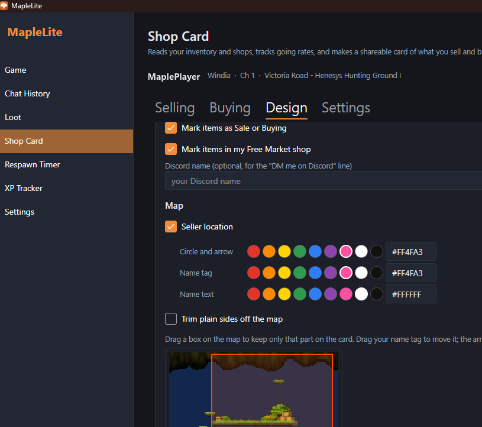
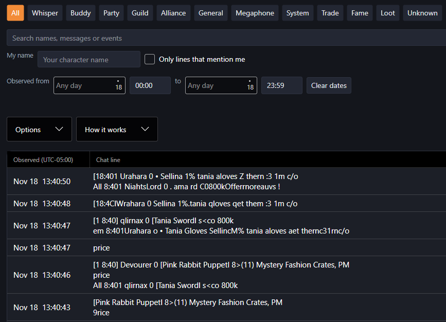
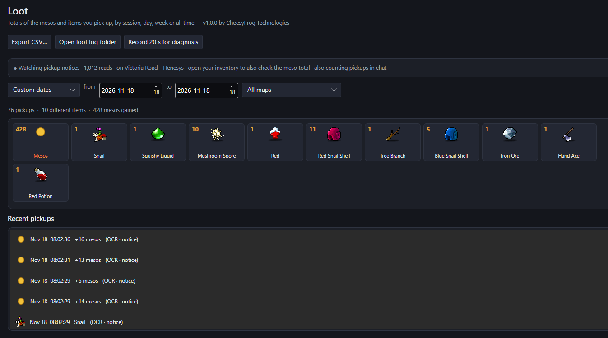
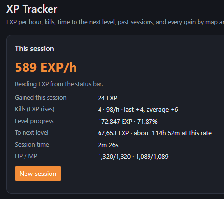
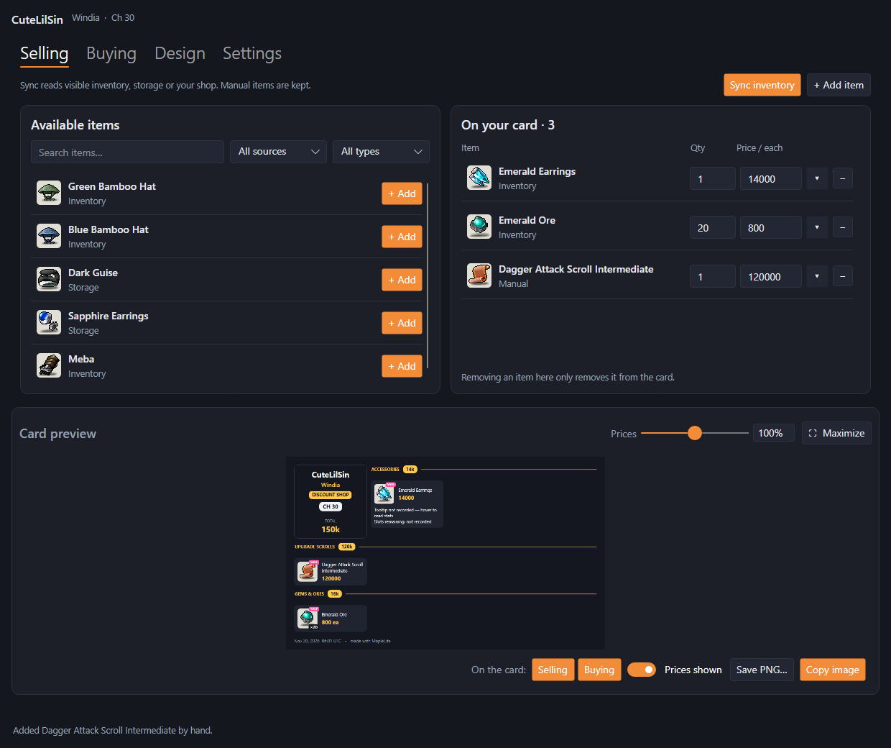
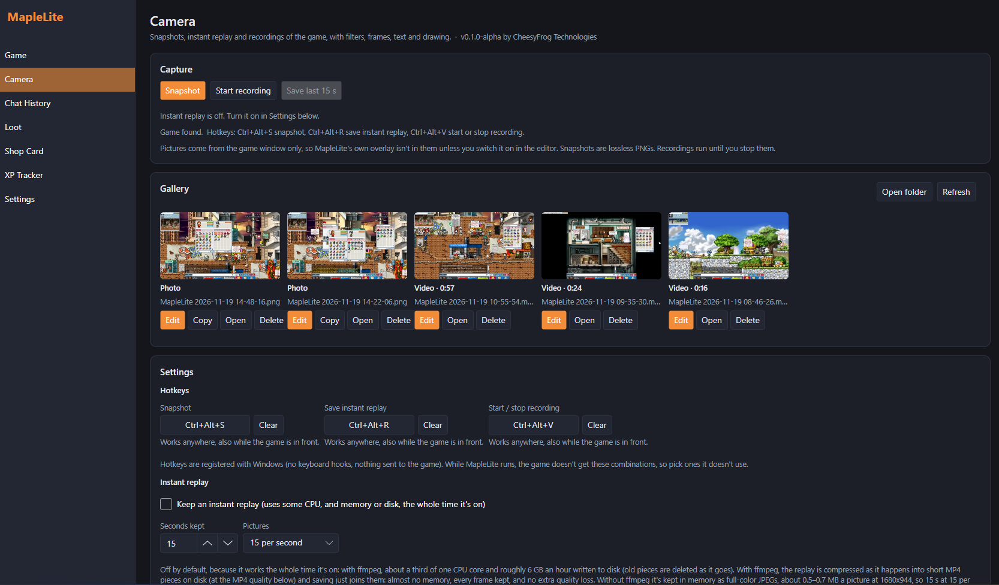

# MapleLite

A plugin host for **MapleStory Classic World**. It runs on **Windows, macOS
and Linux** from one codebase (.NET 8 + Avalonia).

MapleLite is **passive**. It reads the game only from pictures of its window. It never injects code,
reads game memory, captures packets, or sends input to the game, and neither can its plugins.

> [!WARNING]
> **MapleLite is alpha software (0.1.0-alpha).** Expect bugs, missing features and changes between versions,
> including to saved data.
>
> **Plugins read the game with OCR (text recognition on screenshots), so what they show can be wrong.** A misread
> name, price, quantity or number leads to wrong totals, rates and logs. Check anything that matters, such as a price
> before you trade, against the game itself.



## Projects

| Project | What it is |
|---|---|
| `src/MapleLite.Core` | No UI, no OS calls. Frames, the **shared OCR service**, the capture loop, platform interfaces. |
| `src/MapleLite.Sdk` | The plugin API (`IPlugin`, `IPluginContext`), theme tokens, themed panel helpers. Plugins reference only this. |
| `src/MapleLite.Platform.Windows` | Window finding + mode detection, Windows.Graphics.Capture, Windows OCR. |
| `src/MapleLite.Platform.Mac` | macOS: window finding, ScreenCaptureKit capture, Apple Vision OCR, clipboard. Not yet run against the native client. |
| `src/MapleLite.Platform.Linux` | Linux (milestone 5): X11/XComposite for the Wine/Proton window, Tesseract OCR. Stub today. |
| `src/MapleLite.Host` | The Avalonia app: Game page, plugin pages, Settings, themes, plugin loader. |
| `plugins/*` | Bundled plugins: Chat History (the MapleMemory app, ported), Loot Logger, Shop Card, DPS Simulator, XP Tracker, Respawn Timer, Camera, Player Finder. |
| `samples/HelloPlugin` | A minimal third-party plugin to copy. |
| `tests/MapleLite.Tests` | xUnit tests on fake engines and synthetic frames (never the live game). |

## Shared OCR

Platforms provide only a raw recognizer (`IOcrEngine`). Everything else lives once in Core's `OcrService`,
which plugins get as `context.Ocr`:

- crop, cleanup (`OcrPreprocessor`: `ChatGlyphs`, `BrightText`, `Invert`, `Grayscale`, or your own),
  enlarge (auto up to 3×, smooth or nearest, optional padding), recognize, map boxes back to frame coordinates
- optional regrouping of words into on-screen rows (`OcrGrouping.Rows`)
- **sharing**: the capture loop gives every plugin the same frame object, so identical reads of the same frame
  run once, even across plugins
- a concurrency cap so OCR can't starve capture

```csharp
var r = await context.Ocr.ReadAsync(frame, new OcrRequest(chatRegion)
{
    Preprocess = OcrPreprocessor.ChatGlyphs,
    Grouping = OcrGrouping.Rows,
});
foreach (var line in r.Lines) Console.WriteLine($"{line.Box.Y:0}: {line.Text}");
```

## Themes

Seven built-in themes: Midnight, Daybreak, Maple, Forest, Ocean, Sakura, High contrast. Every color is a token
(`ml.Background`, `ml.Surface`, `ml.Accent`, …) published as an app resource. Stock controls are mapped onto
the tokens too, so the host and every plugin page restyle live. Users add themes as JSON in the themes folder
(Settings → *Copy to a file to edit*). A theme may set only some tokens and inherit the rest from a base.

## Overlays

Windows only so far, off by default (Settings → Overlay). See [docs/OVERLAYS.md](docs/OVERLAYS.md) for the safety
rules (never inside the game process, display-only and click-through, unavailable in exclusive fullscreen).
Plugins can also bake what the overlay shows into pictures on purpose: `context.Overlay.Everything()` returns the other
plugins' items and `OverlayPainter` draws them with SkiaSharp (Camera uses this for "include respawn timers").

## Hotkeys

Plugins can register system-wide shortcuts with `context.Hotkeys.Register("Snapshot", "Ctrl+Alt+S", action)`, so actions
work while the game is in front. On Windows they are `RegisterHotKey` registrations on MapleLite's own thread: no keyboard
hooks, nothing loaded into the game, no input sent anywhere. While MapleLite runs, the game doesn't receive those
combinations. macOS and Linux report `Supported = false` for now (plugins keep their buttons).

## Download or build in one step

**Just want to run it?** On 64-bit Windows 10/11, download
[`bin/MapleLite-windows-x64.zip`](bin/MapleLite-windows-x64.zip), unzip it anywhere and run `MapleLite.exe`.
On an Apple Silicon Mac, download [`bin/MapleLite-macos-arm64.zip`](bin/MapleLite-macos-arm64.zip), unzip it and run
`MapleLite` (or `./MapleLite` from Terminal). Both downloads include the .NET runtime.
Intel Mac and Linux builds can be made with the script below.

**Want to build it yourself?** Download or clone this repo and run the script for your system. Each one makes a
standalone copy in `bin/` that runs without .NET installed, plus a zip of it to share. If the
[.NET 8 SDK](https://dotnet.microsoft.com/download/dotnet/8.0) isn't installed, the script offers to install it.

| System | Run | Result |
| --- | --- | --- |
| Windows 10/11, 64-bit | double-click `build-windows.cmd` | `bin\MapleLite-windows-x64\MapleLite.exe` and `.zip` |
| macOS (Apple silicon or Intel) | double-click `build-macos.command` | `bin/MapleLite-macos-arm64/MapleLite` and `.zip` |
| Debian / Ubuntu | `./build.sh` in a terminal | `bin/MapleLite-linux-x64/MapleLite` and `.tar.gz` |

The CPU is picked automatically (`macos-x64` on an Intel Mac, `linux-arm64` on ARM Linux); `./build.sh --rid <rid>`
builds for another one. On macOS, if Finder won't open `build-macos.command`, right-click it and choose **Open**.
Builds are about 130 MB (50 MB zipped), plugins included. Only the zips (and `.tar.gz` files) in `bin/` are committed;
the unzipped folders are ignored by git.

## Build and run (for development)

You need the free [.NET 8 SDK](https://dotnet.microsoft.com/download/dotnet/8.0) (Windows, macOS or Linux) and this repo.
Run the commands in a terminal in the repo folder.

### Windows

```bash
dotnet build
dotnet test
dotnet run --project src/MapleLite.Host -f net8.0-windows10.0.19041.0
```

Build output goes outside the source tree, to `%LOCALAPPDATA%\MapleLite-build\<repo folder>` (this folder is synced by
Google Drive, which locks freshly written build files; each checkout or worktree gets its own subfolder so they can't
overwrite each other). After a build you can also start the app directly from
`%LOCALAPPDATA%\MapleLite-build\MapleLite\bin\MapleLite.Host\debug_net8.0-windows10.0.19041.0\MapleLite.exe`.

To make a standalone copy that runs on any 64-bit Windows 10/11 PC without .NET installed:

```bash
dotnet publish src/MapleLite.Host -f net8.0-windows10.0.19041.0 -r win-x64 -c Release --self-contained -o publish/win
```

Then run `publish\win\MapleLite.exe`, or zip the `publish\win` folder to share it (about 120 MB, plugins included).
If the repo sits in a synced folder (Google Drive, OneDrive), publish outside it, for example
`-o %LOCALAPPDATA%\MapleLite-publish\win`, so the sync client doesn't lock or upload the 120 MB of files.

### macOS

Build on the Mac itself:

```bash
dotnet build
dotnet run --project src/MapleLite.Host -f net8.0
```

Standalone copy (use `osx-x64` instead of `osx-arm64` for Intel Macs):

```bash
dotnet publish src/MapleLite.Host -f net8.0 -r osx-arm64 -c Release --self-contained -o publish/mac
```

Run it with `./publish/mac/MapleLite`. If the folder was built on Windows and copied over, first run
`chmod +x publish/mac/MapleLite` (Windows doesn't keep the "executable" flag). A copy downloaded from the internet is
blocked by Gatekeeper until you run `xattr -dr com.apple.quarantine publish/mac`, because it isn't signed yet.
A proper double-clickable, signed `MapleLite.app` comes with the macOS milestone.

**Status on macOS:** the macOS layer is written (window finding with CGWindowList, ScreenCaptureKit capture with a
CGWindowListCreateImage fallback before macOS 12.3, Apple Vision OCR, PNG clipboard) but hasn't been run against the
native client yet. On the first capture macOS asks for **Screen Recording** permission (System Settings > Privacy &
Security > Screen Recording). When MapleLite is started from Terminal the permission belongs to Terminal; restart
MapleLite after allowing it. Keep the game on the current Space and not minimized.

Good first checks:

- `./publish/mac/MapleLite --ocrtest capture.png --out lines.txt`: Vision OCR on a saved capture, no game needed.
- Game page: the size shown should be the game's picture without the title bar. The title bar is found in the picture
  (a flat gray band 20–40 points tall) and assumed to be 28 points until it has been seen.
- Retina: capture is in physical pixels (2× the window's size in points). If plugins misread because the game draws at
  1× and macOS enlarges it, that's the place to look.

### Linux

Build as on macOS with `-r linux-x64`. The Linux capture and OCR layer (X11 + Tesseract) is still milestone 5, so it
can't see the game yet.

### Test switches (Developer)

Run the built `MapleLite` executable with these. None of them touch the live game:

- `--replay <png>`: run the whole host on a saved capture instead of the game
- `--replay <folder> [--loop]`: play back a session recorded with **Record a session (Developer)** on the Game page (saved under `recordings/` in MapleLite's data folder), in real time, through every plugin
- `--ocrtest <png> --out <txt> [--region x,y,w,h]`: read a saved capture with the shared OCR and write the lines
  (with `--region`: chat-glyph cleanup, compared across enlarge modes)
- `--snapshot <png> [--theme <id>] [--page game|settings|<plugin-id>] [--wait <s>]`: render the window to a PNG and exit
- `--install <zip|dll>` / `--uninstall <plugin-id>`: add or remove a plugin at startup

Set `MAPLELITE_DATA` to a scratch folder to keep test runs away from your real settings.

## Data

`%LOCALAPPDATA%\MapleLite` on Windows, `~/Library/Application Support/MapleLite` on macOS,
`~/.local/share/MapleLite` on Linux: `settings.json`, `themes/`, `plugins/<id>/`, `maplelite.log`.

## Writing a plugin

Reference `MapleLite.Sdk`, implement `IPlugin`, and build to `plugins/<Name>/<Name>.dll`. Each plugin loads in
its own `AssemblyLoadContext`; Core, Sdk and Avalonia come from the host. Use `context.Frames.Subscribe` for
frames (keep the callback short), `context.Game` for what MapleLite already reads for everyone (map and
location with room, minimap size, channel, IGN, HP, MP, EXP: take these from here rather than reading them
yourself), `context.Ocr` for text, `context.Storage` for data, and the `PanelKit`
helpers or `ml.*` resources for a page that follows the theme. Third-party plugins will come through a
reviewed hub that builds them from source.

## Chat History

A chat journal. Its parsers, spam and partial-repeat filters and time filters
are the app's code, unchanged (the loot tracker is now the Loot Logger plugin); its 99 self-test checks run as xUnit tests. What changed: frames come
from the host's capture loop and text from the shared OCR (chat-glyph cleanup, row grouping, bicubic enlarge), and
the page is Avalonia, so it runs on every OS the host does.



- Same line format as the app, one file per day: `messages-YYYY-MM-DD.jsonl`, plus `settings.json`, in
  `plugins/chathistory/` under the MapleLite data folder. Older monthly files are split into days on first start
  (the originals are kept in `monthly-backup/`).
- On first start it **copies** the MapleMemory app's history and chat area from `%LOCALAPPDATA%\MapleMemory`
  (the app's files are never changed). "Import from MapleMemory app" copies any lines added since, without duplicates.
- Checked against the app on a saved capture: the same three messages, channels (Megaphone, Buddy, Megaphone) and
  wrapped-line assembly.

## Loot Logger

Totals of the mesos and items you pick up, by session, day, week or all time, with a CSV export. Moved out of Chat History
into its own plugin.



Pickups come from two places:

- the game's pickup notices in the lower-right of the picture, read by Loot Logger with the shared OCR;
- pickup lines printed in chat, which Chat History publishes on the event bus (when Chat History is on).

Chat History also publishes where the chat box is, and Loot Logger leaves that area out of its own reads so the same pickup
isn't counted twice. Pickups are saved one file per day, as `loot-YYYY-MM-DD.jsonl` in `plugins/loot/`. First start
copies the pickups out of the MapleMemory app's history.

Open **Drop highlights** to set up to five price ranges and choose a color for each. Both bounds include the
entered price. You can leave one bound blank or leave both blank to disable that row. If ranges overlap, the
first matching row wins. Loot Logger colors matching item tiles and recent pickups using the saved item-wide
Shop Card ask or the latest usable Market archive estimate per item. Turn on **Show drop alerts over the game**
to show matching new pickups for five seconds when MapleLite's Windows game overlay is enabled.
Under **Specific items**, search the catalog and recorded pickups, add an item, choose its color, and save.
Item colors take priority over price ranges and work even when the item has no archived price.

## XP Tracker

EXP per hour, kills, time to the next level and HP/MP, read from the status bar, plus past sessions and every EXP gain
by map and time (saved one file per day in `plugins/xptracker/gains/`).



Open **XP Tracker → Party Quests** to see total PQ EXP, totals by quest, and the breakdown for each run.
Select a quest or type its name and click **Start run** before entering. Click **End run** after the final EXP
award appears. Use **Classify reward EXP** on a run to label recorded gains as stage rewards or completion rewards.
Detected rewards without a label appear under **Unclassified rewards**. Earlier EXP remains available in **History**.

## Shop Card



Use **Selling**, **Buying**, **Design** and **Settings** to switch pages. The card preview sits below the editor;
**Enlarge** makes the preview fill the Shop Card page. **Pop out** opens a live, maximized window on another
display when available. Use **Fit width** to scroll a long card at a larger scale. Click a price on a tile
to set its base price before discounts, or use **−** to take it off the card. For a merged tile, **−** removes
all entries represented by that item. Prices are shared across copies of the same stackable item or
equipment with matching recorded stats and remaining slots. The Market database indexes those saved asks.

**Selling** separates **Available items** from **On your card**. Use **Sync** to refresh visible inventory,
storage or your own shop. Open each tab or scroll the game window to expose more items. Explicit **Sync** adds recognized items visible in that scan directly to your card. Background scans
leave newly discovered items in Available items until you press **+ Add** or Sync. Search and the source/type filters only affect the available list;
they never hide or remove your selected items. The **−** button returns an item to Available items without deleting it.
Sync keeps manual and unseen items and existing prices; it reselects recognized visible items even if you previously removed them.
Separate equipment copies are preserved by inventory slot, including copies with identical or unread stats.
The **Equipped** source shows gear recorded in DPS Simulator. **×** dismisses an available entry.
Use **Settings → Restore dismissed items** to let scanned entries come back. **Review prices** filters
to entries with a missing price or a saved **⚑** flag. **Clear card** empties Selling and Buying while
keeping item details, and CSV export suggests `MapleLite-card yyyy-MM-dd HH-ss.csv`.

**+ Add item** searches the bundled database by words in any order, or lets you add an unlisted name without an icon.
Manual entries go straight onto your card. Expand a selected row with **▾** for **Change item…**, stats, going-rate
buttons and price adjustments; manual entries also have **Remove from list**. Inventory corrections are remembered
by icon, except look-alike scrolls, which are remembered for their inventory slot. Shop corrections stay attached
to their original listing; storage scroll corrections become manual entries. Check scroll identities after rearranging slots.

**Missing stats → Review items** above On your card filters to selected equipment/scrolls with incomplete details.
Use **Read stats (5s)** and hover that exact item in-game, keeping its tooltip visible. Inventory row/slot labels help
distinguish identical copies. Manual items offer **Enter stats**. Missing stats do not prevent an item from appearing on the card.

**Buying** uses the same two-list workflow. Search or filter the **Item database**, press **+ Add**, then set the wanted
quantity and offer price on the right. Expand **▾** to add required stats, comparisons (or more / exactly / or less),
and remaining upgrade slots. These requirements appear under “Wants:” on the exported card. Buying is a wish list,
so it has no inventory sync. Removing a Buying entry removes it from the wish list; adding it again starts a new entry.

The **Prices** slider above the preview adjusts the card's prices without changing your entered prices. Each selling
item's **▾** panel has its own adjustment, and **Design → Price adjustments by item type** retains the category controls.
The **Selling** and **Buying** switches beside the export actions show or hide each list on the exported card.

Open your own Free Market shop in the game, then **Sync** and choose **My FM shop** in the source filter.
Press **+ Add** on the recognized listings you want to include. The reader checks for the owner's **Close Store** control; browsing another
player's shop contributes market prices, not your sale items. Scroll the shop list to expose more rows.
Unclear names or prices are skipped. Repeated reads do not add the same observed listing again.

Your own shop's listings are tagged IN SHOP while the shop is open. Sold listings (greyed out) come off the list.
When the shop closes (its window has been gone for a few reads), the unsold listings go back to the inventory with
their prices and stats, merging into the item's inventory card when there is one. Seeing the shop open again makes
them listings again. If the shop closed while MapleLite wasn't watching, Settings → **Move shop listings back** does
it by hand. Identical listings on separate scroll pages cannot always be told apart, and the selected source filter
is remembered.

## DPS Simulator

Open the **DPS Simulator** plugin and use **Record hovered gear (5s)** for each piece of worn gear.
In the game, open the Equipment window and hover the piece to expose its tooltip. MapleLite saves
the result by gear slot and makes it available in Shop Card’s **Equipped** source. Review the recorded
stats and correct any OCR errors using **Edit**. The game window must be visible to the capture service.

Search the gear catalog, load the base stats from MapleClassic Wiki when available or enter a particular
roll, then select **Preview swap**. Equip and preview columns compare estimated DPS, hit chance, damage
per cast and time to defeat. Set your level, job, base AP, and skill and cast timing under **Combat inputs**.
Known prices come from Shop Card and its local Market archive. Mark a specific preview copy as owned to
exclude it from the estimate. **Capture current portrait** reads the in-game portrait, and **Choose preview
image** displays a supplied outfit image alongside the preview’s gear icons.

**Refresh from MapleClassic Wiki** caches the monster table locally. **Add or curate targets** lets you
add newer monsters and override individual records. Refreshes preserve these overrides. Estimates use
the ordinary weapon and spell equations plus Lucky Seven. Enter the element multiplier and cast timing
for your skill and target. The estimate models continuous attacks against a single target.
[Monster data from MapleClassic Wiki](https://mapleclassic.wiki/wiki/Monsters) ·
[Combat formulas from NiaDB](https://meowdb.com/msclassic/guides/explaining-the-damage-formula)

## Player Finder

Open **Player Finder** and choose a readable character name from **Nearby players** for a temporary highlight.
Use **+ Watch** to keep following that character, or type one or more exact names to add them to the watchlist.
Watched players can trigger an alert when spotted. The watchlist saves the last sighting's location,
the channel last read from the game's Change Channel window, and the time in your system's local format.
Turn on **Settings → Overlay** and use windowed or borderless mode on Windows for in-game markers.

- Player Finder outlines readable nameplates, Free Market shop signs, standard overhead speech bubbles, and matching chat lines.
  When nameplates overlap, the speech bubble's pointer can provide an estimated position.
- Minimap markers appear when Player Finder can line up your own nameplate and yellow dot with a visible target's red dot.
- Focus mode dims the surrounding scene and follows the chat panel as it expands or collapses.

## Camera

Snapshots, instant replay and recordings of the game, plus an editor for looks and overlays. Everything comes from the
shared capture loop (the game window's own picture), so MapleLite's overlay is never in a capture unless you switch it on.



- **Snapshot** (Ctrl+Alt+S): a lossless PNG of the game.
- **Instant replay** (Ctrl+Alt+R, off by default: turn it on in the Camera page): saves the last 15 s (5–120, set in the page). While on it works continuously (with ffmpeg about a third of a CPU core and ~6 GB an hour of disk writes). With ffmpeg it's encoded as it
  happens into 2-second H.264 pieces in the data folder (older pieces are deleted), and saving closes the current piece
  and joins them without re-encoding: almost no memory, every frame kept, the clip runs up to the moment you pressed
  save. Without ffmpeg it's kept in memory as full-color JPEGs (about 0.5–0.7 MB a picture at 1680x944).
- **Record** (Ctrl+Alt+V to start and stop): runs until you stop it. With [ffmpeg](https://ffmpeg.org) installed
  (`winget install ffmpeg`, `brew install ffmpeg`) recordings are H.264 MP4s. Measured on 1680x944 game footage
  (worst case, lots of motion): **High** (CRF 16, plays everywhere) about 14 Mbit/s with a mean error of 4/255;
  **Sharpest** (CRF 12, full-color 4:4:4 for crisp small text) about 24 Mbit/s, error 2.4/255; **Lossless** exact
  pixels but about 350 Mbit/s. Without ffmpeg they are folders of full-color JPEG frames in the same layout as session
  recordings (so `--replay` plays them too).
- **Editor** (Edit on any gallery item): looks (black & white, noir, sepia, vintage, warm, cool, vivid, dreamy, night,
  retro 8-bit, invert) with strength, brightness/contrast/saturation/warmth/vignette, frames (simple, Polaroid with a
  caption, film, maple, postcard "Greetings from <map>", neon, rounded), text in four styles, freehand drawing, crop
  with aspect presets, a film-camera date stamp, and other plugins' overlay items as they were at the time (respawn
  timers, …). Clips get the same tools plus trimming, and export to MP4 (ffmpeg) or GIF (built in: a palette per frame
  and only changed areas stored, so they stay small). Edits are saved beside each capture and exports get
  " (edited)" names: originals are never changed.

Captures go to `Pictures/MapleLite` (changeable); MapleLite's notes about them (edits, overlay items, thumbnails) live
in `plugins/camera/media/` in the data folder. Hotkeys are Windows-only for now; the buttons work everywhere.

## Managing plugins

**Settings → Plugins** lists every plugin with an on/off switch. Switching takes effect at once: off stops the plugin
and removes its page (MapleLite also drops any frame or event subscriptions it left behind); on starts a fresh copy.
The choice is remembered.

- **Add plugin…** installs a plugin from a `.zip` (or a single `.dll`) after a warning: plugins run with your access and
  can read your chat, so only add ones you trust. The file is checked first (it must contain a plugin for this API
  version with an id that isn't taken). Added plugins live in `installed-plugins/` in the data folder.
- **Remove** deletes an added plugin's files right away (plugins are loaded from memory, so their files are never
  locked). Its saved data stays in `plugins/<id>/`. Bundled plugins can be switched off but not removed.
- Scripts can do the same: `MapleLite --install <zip|dll>` and `MapleLite --uninstall <plugin-id>`.

`samples/HelloPlugin` is a minimal plugin to copy: it reads text with the shared OCR and listens to chat events.

### Do plugin .dll files work on macOS and Linux?

Yes. A plugin `.dll` built for plain `net8.0` holds .NET bytecode (IL), not Windows machine code. The .NET runtime on
each OS compiles it to native code as it runs, so **the same file works on Windows, macOS (Intel and Apple Silicon)
and Linux**. The `.dll` name is just .NET's file extension on every OS. The bundled plugins are built this way.

What makes a plugin Windows-only:

- targeting `net8.0-windows` instead of `net8.0`;
- calling Windows APIs directly (P/Invoke into `user32.dll` and so on);
- shipping native libraries (`.dll`, `.dylib`, `.so`) for one OS only.

Plugins don't need any of that. Capture, OCR and the window live in MapleLite's platform layer, and plugins reach them
only through `IPluginContext`. On a Mac, users get MapleLite as a self-contained `.app` with the .NET runtime inside,
so they don't install .NET themselves. Plugins are loaded by that runtime, not by macOS, so they need no separate
signing.

## Future plugin ideas

- **Hidden Area Outliner:** shows where hidden portals are in-game, with overlays.
- **NPC Highlighter:** highlights specific NPCs in any color.

## Support Development

If you find this app useful and would like to support its continued development:

- [Sponsor me on GitHub](https://github.com/sponsors/vahnx)
- [Support me through PayPal](https://paypal.me/twitchplaying)
- Bitcoin: `bc1qnl9nvwldzzdnlglqhvlhdm5l04rxawgkezr2ru`

Join the [vahnx Projects Discord](https://discord.gg/bn4HcQWTp) for general support, suggestions and project discussion.

Thank you for your support!

## Disclaimer

This is an unofficial fan project. It is not affiliated with, endorsed by or sponsored by Nexon. MapleStory and its
artwork are trademarks and property of Nexon. Use it in line with the game's terms of service.

### Shop Card UI checks

`dotnet test tests/MapleLite.UiTests/MapleLite.UiTests.csproj` runs the real Avalonia controls with a headless renderer,
including Selling/Buying add/remove, search, filters, quantity/price editing, wanted stats, missing-capture sync and
narrow layout. Set `MAPLELITE_UI_SCREENSHOTS` to a local folder to save rendered screenshots. Tests use isolated temp data.
